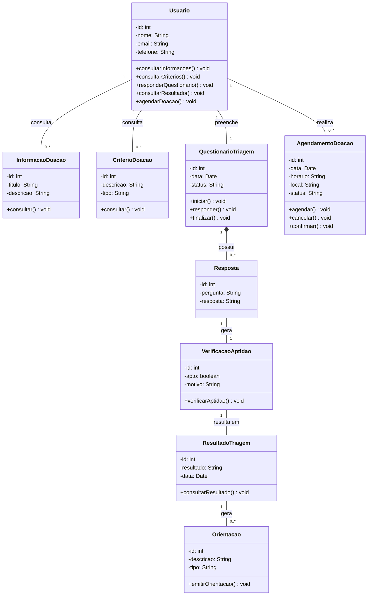
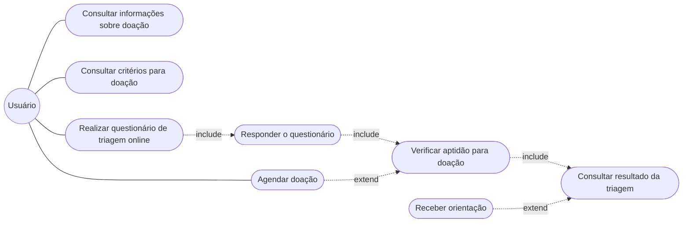

# Transcrição técnica da monografia

> Fonte: `Monografia_Doe_Vida_Atualizada.pdf` (versão recebida em 2026-10-12).
> Este arquivo **transcreve** o que a monografia diz, sem corrigir. As decisões de implementação e as divergências estão em [rastreabilidade.md](rastreabilidade.md).

## Requisitos (§3.1)

**Funcionais**

| ID | Requisito |
|---|---|
| RF-a | Permitir o cadastro de doadores |
| RF-b | Disponibilizar o Questionário de Triagem Clínica online |
| RF-c | Validar automaticamente as respostas do questionário |
| RF-d | Permitir agendamento de doações |
| RF-e | Gerar relatórios de elegibilidade para o hemocentro |
| RF-f | Enviar lembretes e notificações aos doadores |
| RF-g | Permitir login seguro para usuários |

**Não funcionais**

| ID | Requisito |
|---|---|
| RNF-a | Fácil de usar, interface simples |
| RNF-b | Carregar páginas e informações rapidamente |
| RNF-c | Proteger todos os dados, seguindo a LGPD |
| RNF-d | Funcionar em computadores e celulares |
| RNF-e | Suportar muitos acessos ao mesmo tempo (alta disponibilidade) |
| RNF-f | Mensagens claras para evitar erros do usuário |

**Restrições do TAP (Anexo A, §8)** relevantes ao código: somente fontes oficiais; caráter informativo, sem diagnóstico; **sem integração com sistemas internos de hemocentros**; **sem armazenar dados sensíveis além do estritamente necessário**; apenas ferramentas gratuitas.

## Diagrama de Classes (Figura 4)



## Diagrama de Casos de Uso (Figura 5)

Ator: **Usuário**.



## Dicionário de dados (§3.2.2)

| Coleção | Campos |
|---|---|
| Usuários | idUsuario (String), nome (String), email (String), dataNascimento (Date), telefone (String), dataCadastro (Timestamp) |
| Questionários | idQuestionario (String), titulo (String), descricao (String), perguntas (Array), ativo (Boolean) |
| Respostas | idResposta (String), idUsuario (String), idQuestionario (String), respostas (Array), resultadoTriagem (String), dataResposta (Timestamp) |
| Agendamentos | idAgendamento (String), idUsuario (String), idHemocentro (String), data (Date), horario (String), status (String: agendado/cancelado/concluído), dataCriacao (Timestamp) |

## Quadros de código (§3.2.2 Implementação)

**Quadro 1: cadastro e autenticação**
```js
import { createUserWithEmailAndPassword, signInWithEmailAndPassword } from "firebase/auth";
async function cadastrar(email, senha) { return createUserWithEmailAndPassword(auth, email, senha); }
async function entrar(email, senha) { return signInWithEmailAndPassword(auth, email, senha); }
```

**Quadro 2: triagem preliminar**
```js
function verificarTriagem({ idade, peso, febre }) {
  const impedido = idade < 16 || peso < 50 || febre;
  return impedido ? "Não apto no momento" : "Apto para avaliação";
}
const resultado = verificarTriagem({ idade: Number(idadeInput.value), peso: Number(pesoInput.value), febre: febreInput.checked });
resultadoElement.textContent = resultado;
```

**Quadro 3: agendamento**
```js
import { addDoc, collection, Timestamp } from "firebase/firestore";
async function agendar(uid, hemocentro, data, horario) {
  return addDoc(collection(db, "Agendamentos"), {
    idUsuario: uid, idHemocentro: hemocentro, data, horario,
    status: "agendado", dataCriacao: Timestamp.now()
  });
}
```

## Protótipo (Figura 3)

Navbar: Sobre nós · Triagem · Informações · Qualificação · Login. Hero: "Um gesto simples, até quatro vidas salvas.", botões "Fazer pré-triagem" e "Saber mais sobre a doação", selo "Estoque crítico de sangue O-", números "4 vidas salvas por doação · 450 ml · 60 dias (homens) · 90 dias (mulheres)", "Recolha em 30 a 40 minutos", "Sem jejum". Paleta: vermelho e branco, cantos arredondados, visual acolhedor.
